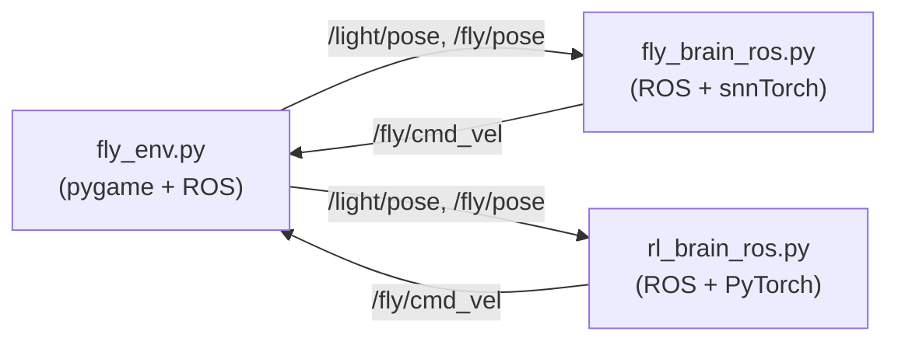

# Fly Brain Phototaxis in ROS 2

<p align="center">
  <b>Driving a simulated fruit fly with a connectome-scale spiking brain model and a Reinforcement Learning benchmark</b><br>
  <i>A ROS 2 project built on top of the snnTorch port of the Drosophila brain</i>
</p>

<p align="center">
  <a href="README.zh-CN.md">中文文档</a> ·
  <a href="#demo">Demo</a> ·
  <a href="#overview">Overview</a> ·
  <a href="#benchmark">Benchmark</a> ·
  <a href="#architecture">Architecture</a> ·
  <a href="#installation">Installation</a> ·
  <a href="#usage">Usage</a>
</p>

---

## Demo

Here is a comparison between the biological Spiking Neural Network (SNN) brain and the trained Reinforcement Learning (RL) agent in the same ROS 2 environment:

| Biological Brain (127K-neuron SNN) | Reinforcement Learning Agent (PPO) |
| :---: | :---: |
| *Asynchronous, computational heavy* | *Synchronous, sub-millisecond inference* |
|  |  |
| **[Insert your SNN GIF here]** | **[Insert your RL GIF here]** |

> *(Note: The SNN runs slowly on CPU and requires asynchronous thread decoupling, resulting in "stuttering" motion. The RL agent runs at 30Hz smoothly.)*

---

## Overview

This project closes the loop between a **127,000-neuron spiking model of the adult Drosophila brain** and a **2D simulated fly** rendered in a ROS 2 environment. A virtual light source orbits the arena, and the fly must perform phototaxis to chase it.

To evaluate the performance of bio-inspired computation, **I also trained a Reinforcement Learning (PPO) agent** with the exact same kinematic constraints and action spaces as a benchmark.

The biological brain model reuses the sparse snnTorch port by **Michał Antropik (Neuromorphicism)**:
> **Upstream brain model**: https://github.com/Neuromorphicism/fly-brain-snntorch
> 
> Paper: P. K. Shiu, G. R. Sterne, N. Spiller et al. *"A Drosophila computational brain model reveals sensorimotor processing"* Nature, 2024.

> **Note on vision**: The FlyWire central brain lacks a complete visual system, so I mapped light intensity onto the **sugar gustatory pathway**. The brain's output (MN9 motor neuron) is decoded back into a steering command.

---

## Benchmark

Why use Reinforcement Learning? Here is the performance comparison I measured:

| Metric | SNN Brain (`fly_brain_ros.py`) | RL Agent (`rl_brain_ros.py`) |
|---|---|---|
| **Model Size** | 127,400 neurons | ~10,000 parameters (MLP) |
| **Inference Latency** | ~500 ms / step (CPU) | < 1 ms / step (CPU) |
| **Control Frequency** | Async (2 Hz simulation, 10 Hz control)| Synchronous (30 Hz) |
| **Trajectory Quality** | Stuttering, reactive | Smooth, predictive interception |
| **Training Method** | Evolutionary (Connectome) | PPO (Reinforcement Learning) |

**Key Insight**: The biological connectome contains extreme biological realism but suffers from massive computational overhead on standard CPUs. By training an RL agent with a simplified reward function (distance reduction), we achieve **500x faster inference** and highly smooth control in the same environment.

---

## Architecture



**Signal flow (SNN)**:
1. **Perception**: Compute bearing error between fly heading and light position.
2. **Encoding**: Map left/right light into Poisson spike rate (10–200 Hz) on sugar GRNs.
3. **Brain**: Run one step of the full FlyWire LIF network (sparse CSR).
4. **Decoding**: Read MN9 firing rate → steering command.
5. **Actuation**: Publish `Twist` on `/fly/cmd_vel`.

**Signal flow (RL)**:
1. **State**: `[dx, dy, sin(err), cos(err), dist]` normalized.
2. **Inference**: PyTorch MLP forward pass.
3. **Action**: `[v, w]` → publish `Twist`.

---

## Files

| File | Purpose |
|---|---|
| `fly_env.py` | pygame 2D world, ROS environment node |
| `fly_brain_ros.py` | Biological SNN brain thread + ROS controller |
| `rl_brain_ros.py` | Reinforcement Learning (PyTorch) ROS controller |
| `fly_rl_env.py` | Custom Gymnasium environment for RL training (kinematics aligned) |
| `train_ppo.py` | Training script for PPO agent + weight exporter |
| `make_assets.py` | Generates `assets/grass.png`, `assets/fly.png`, `assets/light.png` |
| `assets/` | Replaceable PNG sprites |
| `data/` | FlyWire v630 completeness CSV + connectivity parquet |

---

## Environment & Installation

### 1. ROS 2 (Jazzy or newer)
```bash
source /opt/ros/jazzy/setup.bash
```

### 2. Python Environment
```bash
conda activate ros2_env
pip install pygame pillow
# Requires PyTorch for both models
```

> ⚠️ Do **not** install `pygame` via `conda install` in a ROS env (conflicts with Qt).

### 3. Brain Data (For SNN only)
Download FlyWire v630 files and place them in `data/`:
- `2023_03_23_completeness_630_final.csv`
- `2023_03_23_connectivity_630_final.parquet`
Source: https://github.com/philshiu/Drosophila_brain_model

### 4. RL Training Environment (Optional)
If you want to retrain the RL agent, create a separate environment to avoid dependency conflicts:
```bash
conda create -n fly_rl python=3.10
conda activate fly_rl
pip install torch gymnasium stable-baselines3 numpy
python train_ppo.py
# This generates `actor_weights.pt` for the ROS node.
```

---

## Usage

Open **two terminals** (using `ros2_env`).

**Terminal A — Environment**
```bash
python fly_env.py
```

**Terminal B — Choose your Brain**
*Option 1: Biological SNN (Requires data)*
```bash
python fly_brain_ros.py
```
*Option 2: Reinforcement Learning (Fast & Smooth)*
```bash
python rl_brain_ros.py
```

---

## Credits

This project is a downstream ROS 2 integration and RL benchmark. The core SNN brain model is **not** my work — it is the snnTorch port by **Michał Antropik**:
- **Upstream repository**: https://github.com/Neuromorphicism/fly-brain-snntorch
- **Original Brian2 model**: https://github.com/philshiu/Drosophila_brain_model

## License
The upstream brain model and its data are distributed under the MIT license. This ROS 2 integration and RL benchmark are released under the same terms.
