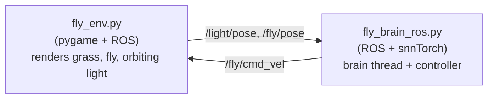

# Fly Brain Phototaxis in ROS 2

<p align="center">
  <b>Driving a simulated fruit fly with a connectome-scale spiking brain model</b><br>
  <i>A ROS 2 project built on top of the snnTorch port of the Drosophila brain</i>
</p>

<p align="center">
  <a href="README.zh-CN.md">中文文档</a> ·
  <a href="#overview">Overview</a> ·
  <a href="#architecture">Architecture</a> ·
  <a href="#installation">Installation</a> ·
  <a href="#usage">Usage</a> ·
  <a href="#credits">Credits</a>
</p>

---

## Overview

This project closes the loop between a **127,000-neuron spiking model of the
adult Drosophila brain** and a **2D simulated fly** rendered in a ROS 2
environment.

A virtual light source orbits the arena. The fly only "sees" the light through
a **sugar gustatory pathway** borrowed from Shiu et al. 2024 — the model was
originally validated on taste, not vision, so we map light intensity onto the
sugar GRN firing rate. The brain's output is decoded back into a steering
command that drives the fly toward the light.

The project reuses the sparse snnTorch port by **Michał Antropik
(Neuromorphicism)**:

> **Upstream brain model**: https://github.com/Neuromorphicism/fly-brain-snntorch
>
> Based on the Brian2 implementation by **Shiu et al.**:
> https://github.com/philshiu/Drosophila_brain_model
>
> Paper: P. K. Shiu, G. R. Sterne, N. Spiller et al.
> *"A Drosophila computational brain model reveals sensorimotor processing"*
> Nature, vol. 634, no. 8032, pp. 210–219, 2024.

---

## Architecture



**Signal flow**

| Stage | Description |
|---|---|
| 1. Perception | Compute bearing error between fly heading and light position |
| 2. Encoding | Map left/right light into Poisson spike rate (10–200 Hz) on sugar GRNs |
| 3. Brain | Run one step of the full FlyWire LIF network (sparse CSR) |
| 4. Decoding | Read MN9 (proboscis motor neuron) firing rate → steering command |
| 5. Actuation | Publish `Twist` on `/fly/cmd_vel` |

> **Note on vision**: The FlyWire central brain does not contain a complete
> visual system. We reuse the sugar pathway because it is the best-validated
> sensorimotor circuit in the model. Light intensity is therefore encoded as
> "sweetness".

---

## Files

| File | Purpose |
|---|---|
| `fly_env.py` | pygame 2D world, publishes `/fly/pose` and `/light/pose`, subscribes `/fly/cmd_vel` |
| `fly_brain_ros.py` | Brain simulation thread + ROS controller |
| `make_assets.py` | Generates `assets/grass.png`, `assets/fly.png`, `assets/light.png` |
| `assets/` | Replaceable PNG sprites (grass, fly, light) |
| `data/` | FlyWire v630 completeness CSV + connectivity parquet |
| `model/` | Cached sparse weight matrix (`fly_brain_connections_weights.pth`) |

---

## Installation

### 1. ROS 2 (Jazzy or newer)

This project assumes a working ROS 2 installation. On Ubuntu:

```bash
source /opt/ros/jazzy/setup.bash
```

### 2. Python environment

Use the same Python environment where ROS 2 Python bindings are available:

```bash
conda activate ros2_env
pip install pygame pillow
```

> ⚠️ Do **not** try to install `pygame` via `conda install` in a ROS
> environment — the dependency solver will conflict with `qt-main` /
> `sdl2_mixer` chains.

### 3. Brain data

Download the FlyWire v630 files and place them in `data/`:

- `2023_03_23_completeness_630_final.csv`
- `2023_03_23_connectivity_630_final.parquet`

Source: https://github.com/philshiu/Drosophila_brain_model

### 4. Generate sprites

```bash
python make_assets.py
```

---

## Usage

Open **two terminals**.

**Terminal A — environment**

```bash
conda activate ros2_env
cd fly-brain-snntorch
python fly_env.py
```

A window appears: grass background, a fly sprite, and a light orbiting the
arena.

**Terminal B — brain + controller**

```bash
conda activate ros2_env
cd fly-brain-snntorch
python fly_brain_ros.py
```

The fly chases the orbiting light.

### Topics

| Topic | Type | Direction |
|---|---|---|
| `/fly/cmd_vel` | `geometry_msgs/Twist` | Controller → Environment |
| `/fly/pose` | `geometry_msgs/Pose2D` | Environment → Controller |
| `/light/pose` | `geometry_msgs/Pose2D` | Environment → Controller |

---

## Configuration

All tunable parameters are at the top of each file.

**`fly_env.py`**

```python
WIN_W, WIN_H   = 800, 600      # window size
FLY_SPEED_PX   = 80.0          # pixels/s at linear.x = 1.0
LIGHT_R        = 200.0         # orbit radius (px)
LIGHT_OMEGA    = 0.6           # orbit speed (rad/s)
```

**`fly_brain_ros.py`**

```python
BRAIN_HZ       = 2             # brain simulation frequency
CTRL_HZ        = 10            # control loop frequency
TURN_GAIN      = 3.5
BASE_SPEED     = 1.2
SLOW_SPEED     = 0.3
```

### Swapping sprites

Replace any PNG in `assets/` — no code change needed.

| File | Recommended size | Notes |
|---|---|---|
| `grass.png` | 800×600 or larger | background |
| `fly.png` | 64×64 or 128×128 | transparent, head pointing **up** |
| `light.png` | 96×96 | transparent |

---

## Troubleshooting

| Symptom | Fix |
|---|---|
| `ModuleNotFoundError: pygame` | `pip install pygame` (not `conda install`) |
| Conda solver conflict on pygame | Install via pip; conda ROS stack conflicts with sdl2_mixer |
| `MN9 ID not found` warning | Brain output is ignored, fly still converges via `err` term |
| Brain step too slow | Lower `BRAIN_HZ` to 1 or 0.5 |
| Fly sprite rotated wrong | Adjust `rot_deg` offset in `fly_env.py` |

---

## Credits

This project is a downstream ROS 2 integration. The core brain model is
**not** ours — it is the snnTorch port by **Michał Antropik**:

- **Upstream repository**: https://github.com/Neuromorphicism/fly-brain-snntorch
- **Original Brian2 model**: https://github.com/philshiu/Drosophila_brain_model
- **Paper**: Shiu, Sterne, Spiller et al., *Nature* 634, 210–219 (2024)
  https://doi.org/10.1038/s41586-024-07763-9

Additional references used in the upstream port:

1. F. Wang, B. H. Theilman, F. Rothganger et al. *"Neuromorphic Simulation of
   Drosophila Melanogaster Brain Connectome on Loihi 2"*, arXiv, 2025.
2. P. Schlegel, Y. Yin, A. S. Bates et al. *"Whole-brain annotation and
   multi-connectome cell typing of Drosophila"*, Nature, vol. 634, 2024.
3. A. Matsliah, S. Yu, K. Kruk et al. *"Neuronal parts list and wiring diagram
   for a visual system"*, Nature, vol. 634, 2024.

---

## License

The upstream brain model and its data are distributed under the MIT license.
This ROS 2 integration is released under the same terms.

The software is provided "as is", with no guarantee of performance, safety,
or fitness for a purpose.
