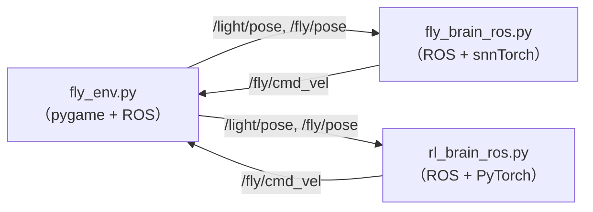

# ROS 2 果蝇趋光仿真

<p align="center">
  <b>用连接组规模脉冲神经网络与强化学习基准驱动虚拟果蝇</b><br>
  <i>基于 snnTorch 果蝇全脑模型的 ROS 2 工程项目</i>
</p>

<p align="center">
  <a href="README.md">English</a> ·
  <a href="#演示对比">演示对比</a> ·
  <a href="#概述">概述</a> ·
  <a href="#性能对比">性能对比</a> ·
  <a href="#架构">架构</a> ·
  <a href="#安装与训练">安装与训练</a> ·
  <a href="#使用方法">使用方法</a>
</p>

---

## 演示对比

以下是生物脉冲神经网络（SNN）与训练好的强化学习（RL）模型在同一 ROS 2 环境中的运行对比：

| 生物大脑 (12.7 万神经元 SNN) | 强化学习智能体 (PPO) |
| :---: | :---: |
| *异步计算* | *同步计算* |
|  |  |
| **[此处替换为你的 SNN 动图]** | **[此处替换为你的 RL 动图]** |

> *(注：SNN 在 CPU 上运行极其缓慢，需要异步线程解耦，导致动作卡顿。而 RL 模型以 30Hz 丝滑运行。)*

---

## 概述

本项目把一个 **12.7 万神经元的成年果蝇脉冲大脑模型**，和一个用 ROS 2 渲染的 **2D 虚拟果蝇** 闭合成一个趋光控制回路。

为了评估生物启发式计算的实际性能，**我还使用完全相同的运动学约束和动作空间，训练了一个强化学习（PPO）智能体作为基准对比。**

> **关于视觉的说明**：FlyWire 中央脑不含完整的视觉系统，因此我将光强映射为了**糖味觉通路**。模型输出（MN9 运动神经元）被解码为转向指令。

---

## 性能对比 (Benchmark)

为什么引入强化学习？这是我在测试后得到的性能对比：

| 指标 | SNN 大脑 (`fly_brain_ros.py`) | 强化学习智能体 (`rl_brain_ros.py`) |
|---|---|---|
| **模型规模** | 127,400 神经元 | ~10,000 参数 (MLP) |
| **推理延迟** | ~500 ms / 步 (CPU) | < 1 ms / 步 (CPU) |
| **控制频率** | 异步 (2Hz 仿真, 10Hz 控制) | 同步 (30Hz) |
| **轨迹质量** | 纯反应式 | 具备预测性截击 |

**核心结论**：生物连接组具有极致的生物学真实性，但在标准 CPU 上带来了巨大的计算开销。通过训练 RL 智能体，我们在同一环境下实现了 **500 倍的推理提速**和极其平滑的控制。

---

## 架构



---

## 文件说明

| 文件 | 作用 |
|---|---|
| `fly_env.py` | pygame 2D 世界，ROS 环境节点 |
| `fly_brain_ros.py` | 生物 SNN 大脑线程 + ROS 控制器 |
| `rl_brain_ros.py` | 强化学习（PyTorch）ROS 控制器 |
| `fly_rl_env.py` | 用于 RL 训练的自定义 Gymnasium 环境 |
| `train_ppo.py` | PPO 智能体训练脚本及权重导出工具 |
| `actor_weights.pt` | **已训练好的 RL 模型权重**（已包含在仓库中）|
| `make_assets.py` | 生成 `assets/` 下的素材图片 |
| `data/` | FlyWire v630 完整性 CSV + 连接组 parquet |

---

## 安装与训练

### 1. 前置要求
```bash
source /opt/ros/jazzy/setup.bash
```

### 2. ROS 环境准备（用于运行两个模型）
```bash
conda activate ros2_env
pip install pygame pillow torch numpy pandas pyarrow
```
> ⚠️ **不要**在 ROS 环境里用 `conda install pygame` —— 会和 Qt 依赖冲突。

### 3. 大脑数据（仅 SNN 需要）
下载 FlyWire v630 文件放到 `data/`：
- `2023_03_23_completeness_630_final.csv`
- `2023_03_23_connectivity_630_final.parquet`

### 4. RL 训练指南（可选 / 用于复现基准对比）
**绝对不要在 `ros2_env` 里训练！** 请新建一个环境以避免污染 ROS 依赖：
```bash
# 1. 创建并激活独立的 RL 环境
conda create -n fly_rl python=3.10 -y
conda activate fly_rl

# 2. 安装 RL 依赖包
pip install torch gymnasium stable-baselines3 numpy

# 3. 运行训练脚本
python train_ppo.py

# 4. 脚本会自动导出纯 PyTorch 权重 (actor_weights.pt)
```
---

## 使用方法

**请保持终端 A 在后台运行**，不要关闭它，然后再运行终端 B。

**终端 A —— 环境仿真（保持不关）**
```bash
conda activate ros2_env
python fly_env.py
```

**终端 B —— 启动你的大脑（新开一个终端）**
*选项 1：生物 SNN*
```bash
conda activate ros2_env
python fly_brain_ros.py
```
*选项 2：强化学习模型*
```bash
conda activate ros2_env
python rl_brain_ros.py
```

---

## 致谢

本项目是 ROS 2 下游集成及 RL 基准测试。核心 SNN 大脑模型**不是我的工作**，它是 **Michał Antropik** 的 snnTorch 移植：
- **上游仓库**：https://github.com/Neuromorphicism/fly-brain-snntorch

## 许可证
上游大脑模型及其数据采用 MIT 许可证。本 ROS 2 集成与 RL 基准测试采用相同条款发布。
