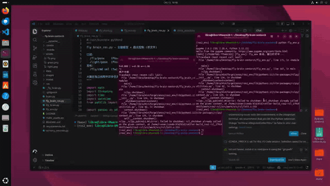
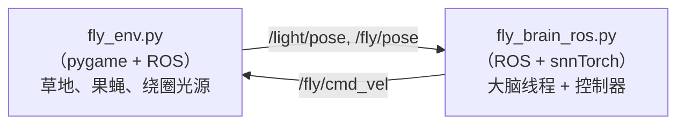

# ROS 2 果蝇趋光仿真

<p align="center">
  <b>用连接组规模脉冲神经网络驱动一个虚拟果蝇</b><br>
  <i>基于 snnTorch 果蝇全脑模型的 ROS 2 工程项目</i>
</p>

<p align="center">
  <a href="README.md">English</a> ·
  <a href="#概述">概述</a> ·
  <a href="#架构">架构</a> ·
  <a href="#安装">安装</a> ·
  <a href="#使用方法">使用方法</a> ·
  <a href="#致谢">致谢</a>
</p>

---

## 概述

本项目把一个 **12.7 万神经元的成年果蝇脉冲大脑模型**，和一个用 ROS 2
渲染的 **2D 虚拟果蝇** 闭合成一个趋光控制回路。

场景中有一个绕圈的光源。果蝇"看不到"光——它是通过**糖味觉通路**
感知光强的（该通路来自 Shiu et al. 2024，模型最初在味觉上被验证，
而不是视觉）。我们人为把光强映射为糖感觉神经元的放电频率，
再把大脑的输出解码成转向指令，驱动机器人朝光源移动。

本项目复用了 **Michał Antropik (Neuromorphicism)** 的 snnTorch 稀疏移植：

> **上游大脑模型**：https://github.com/Neuromorphicism/fly-brain-snntorch
>
> 基于 **Shiu et al.** 的 Brian2 实现：
> https://github.com/philshiu/Drosophila_brain_model
>
> 论文：P. K. Shiu, G. R. Sterne, N. Spiller et al.
> *"A Drosophila computational brain model reveals sensorimotor processing"*
> Nature, vol. 634, no. 8032, pp. 210–219, 2024.

---

## 架构



**信号流**

| 阶段 | 说明 |
|---|---|
| 1. 感知 | 计算果蝇朝向与光源方向的夹角 |
| 2. 编码 | 左右光强映射为泊松脉冲频率（10–200 Hz）注入糖 GRN |
| 3. 大脑 | 运行一步 FlyWire 全脑 LIF 网络（稀疏 CSR） |
| 4. 解码 | 读取 MN9（喙运动神经元）放电率 → 转向指令 |
| 5. 执行 | 在 `/fly/cmd_vel` 上发布 `Twist` |

> **关于视觉的说明**：FlyWire 中央脑不含完整的视觉系统。
> 我们复用了糖通路，因为它是模型中被验证得最充分的感知-运动回路。
> 所以光强在模型内部被编码为"甜度"。

---

## 文件说明

| 文件 | 作用 |
|---|---|
| `fly_env.py` | pygame 2D 世界，发布 `/fly/pose` 和 `/light/pose`，订阅 `/fly/cmd_vel` |
| `fly_brain_ros.py` | 大脑仿真线程 + ROS 控制器 |
| `make_assets.py` | 生成 `assets/grass.png`、`assets/fly.png`、`assets/light.png` |
| `assets/` | 可替换的 PNG 素材（草地、果蝇、光源） |
| `data/` | FlyWire v630 完整性 CSV + 连接组 parquet |
| `model/` | 缓存的稀疏权重矩阵（`fly_brain_connections_weights.pth`） |

---

## 安装

### 1. ROS 2（Jazzy 或更新）

本项目假设你已经装好 ROS 2。Ubuntu 下：

```bash
source /opt/ros/jazzy/setup.bash
```

### 2. Python 环境

用能访问 ROS 2 Python 绑定的环境：

```bash
conda activate ros2_env
pip install pygame pillow
```

> ⚠️ **不要**在 ROS 环境里用 `conda install pygame` —— conda 求解器会
> 和 `qt-main` / `sdl2_mixer` 依赖链冲突。

### 3. 大脑数据

下载 FlyWire v630 文件放到 `data/`：

- `2023_03_23_completeness_630_final.csv`
- `2023_03_23_connectivity_630_final.parquet`

来源：https://github.com/philshiu/Drosophila_brain_model

### 4. 生成素材

```bash
python make_assets.py
```

---

## 使用方法

开**两个终端**。

**终端 A —— 环境**

```bash
conda activate ros2_env
cd fly-brain-snntorch
python fly_env.py
```

弹出窗口：草地背景、一只果蝇、一个绕圈的光源。

**终端 B —— 大脑 + 控制器**

```bash
conda activate ros2_env
cd fly-brain-snntorch
python fly_brain_ros.py
```

果蝇开始追光源。

### 话题

| 话题 | 类型 | 方向 |
|---|---|---|
| `/fly/cmd_vel` | `geometry_msgs/Twist` | 控制器 → 环境 |
| `/fly/pose` | `geometry_msgs/Pose2D` | 环境 → 控制器 |
| `/light/pose` | `geometry_msgs/Pose2D` | 环境 → 控制器 |

---

## 参数配置

每个文件顶部的参数都可以调。

**`fly_env.py`**

```python
WIN_W, WIN_H   = 800, 600      # 窗口尺寸
FLY_SPEED_PX   = 80.0          # linear.x=1.0 时的像素速度
LIGHT_R        = 200.0         # 光源绕圈半径（像素）
LIGHT_OMEGA    = 0.6           # 绕圈角速度（rad/s）
```

**`fly_brain_ros.py`**

```python
BRAIN_HZ       = 2             # 大脑仿真频率
CTRL_HZ        = 10            # 控制循环频率
TURN_GAIN      = 3.5
BASE_SPEED     = 1.2
SLOW_SPEED     = 0.3
```

### 换图片

直接替换 `assets/` 里的 PNG，代码不用改。

| 文件 | 建议尺寸 | 说明 |
|---|---|---|
| `grass.png` | 800×600 或更大 | 背景 |
| `fly.png` | 64×64 或 128×128 | 透明背景，**头朝上** |
| `light.png` | 96×96 | 透明背景 |

---

## 常见问题

| 现象 | 解决 |
|---|---|
| `ModuleNotFoundError: pygame` | `pip install pygame`（不要用 conda） |
| conda 装 pygame 求解失败 | 改用 pip；conda ROS 栈和 sdl2_mixer 冲突 |
| 打印 `MN9 ID not found` | 大脑输出被忽略，靠 `err` 项仍能趋光 |
| 大脑一步太慢 | `BRAIN_HZ` 降到 1 或 0.5 |
| 果蝇图标方向反了 | 调整 `fly_env.py` 里 `rot_deg` 的偏移量 |

---

## 致谢

本项目只是 ROS 2 下游集成。核心大脑模型**不是我们做的** —— 它是
**Michał Antropik** 的 snnTorch 移植：

- **上游仓库**：https://github.com/Neuromorphicism/fly-brain-snntorch
- **原始 Brian2 模型**：https://github.com/philshiu/Drosophila_brain_model
- **论文**：Shiu, Sterne, Spiller et al., *Nature* 634, 210–219 (2024)
  https://doi.org/10.1038/s41586-024-07763-9

上游移植还引用了以下工作：

1. F. Wang, B. H. Theilman, F. Rothganger et al. *"Neuromorphic Simulation of
   Drosophila Melanogaster Brain Connectome on Loihi 2"*, arXiv, 2025.
2. P. Schlegel, Y. Yin, A. S. Bates et al. *"Whole-brain annotation and
   multi-connectome cell typing of Drosophila"*, Nature, vol. 634, 2024.
3. A. Matsliah, S. Yu, K. Kruk et al. *"Neuronal parts list and wiring diagram
   for a visual system"*, Nature, vol. 634, 2024.

---

## 许可证

上游大脑模型及其数据采用 MIT 许可证。本 ROS 2 集成采用相同条款发布。

软件按"原样"提供，不保证性能、安全或特定用途适用性。
